# NewWorld - 신세계

[](https://github.com/ryushin01/NewWorld/actions/workflows/ci.yml)


피라미드와 잉카 유적부터 아발론과 에덴 동산까지, 역사와 신화·전설 속 여행지를 탐험하고 기록하는 모바일 앱입니다.

> **프로젝트 상태:** 포트폴리오용 앱이며 스토어에는 출시하지 않았습니다. 서버 없이 가상 데이터로 동작하는 데모 모드로 실행되고, 변경 내용은 기기에 저장됩니다. Supabase 설정 값을 넣으면 서버 동기화로 전환됩니다.

## 화면

저장한 장소와 기록, 계정은 모두 가상 데이터입니다.

| 실존 유적                                                                                                                                                              | 환상 세계                                                                                                                                                            |
| ---------------------------------------------------------------------------------------------------------------------------------------------------------------------- | -------------------------------------------------------------------------------------------------------------------------------------------------------------------- |
| 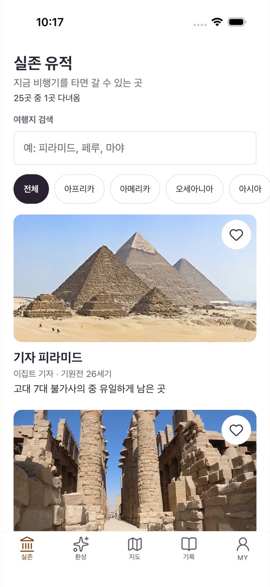 | 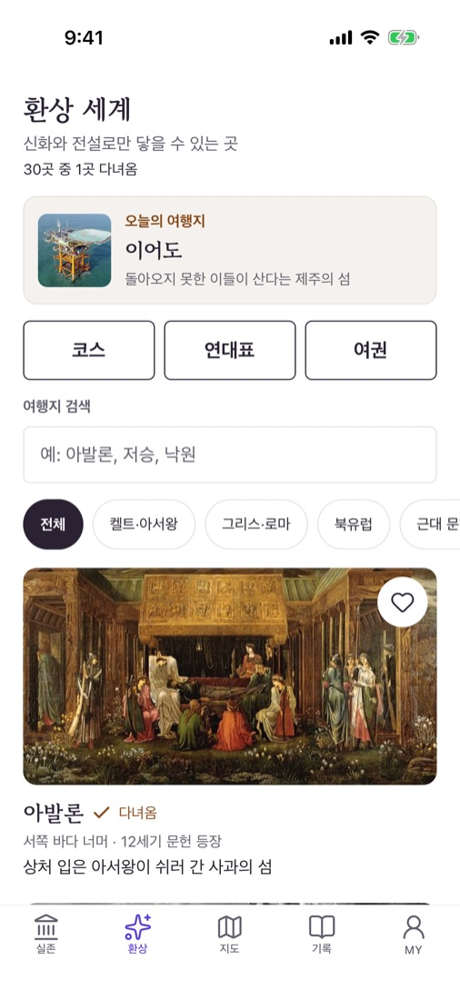 |

| 여행지 상세                                                                                                                                                                          | 현실의 연고지                                                                                              |
| ------------------------------------------------------------------------------------------------------------------------------------------------------------------------------------ | ---------------------------------------------------------------------------------------------------------- |
| 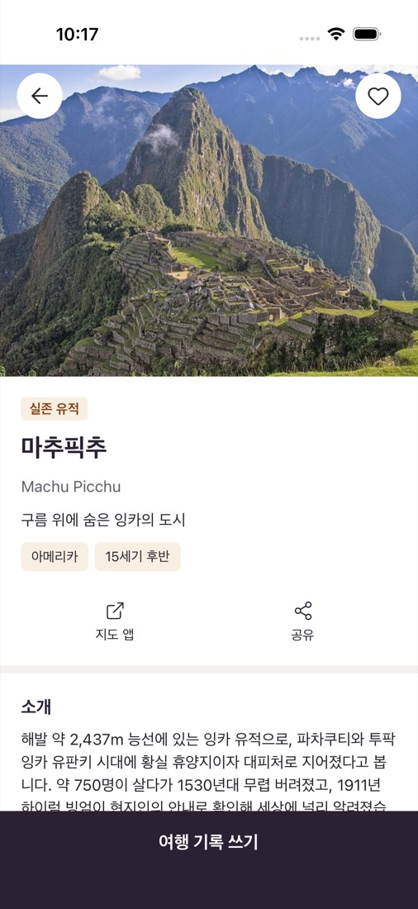 | 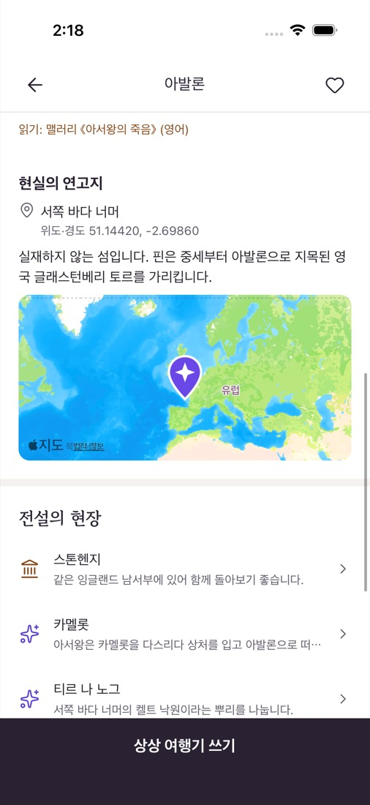 |

| 현장 인증                                                                                                                                   | 기념 뱃지                                                                                                                             |
| ------------------------------------------------------------------------------------------------------------------------------------------- | ------------------------------------------------------------------------------------------------------------------------------------- |
| 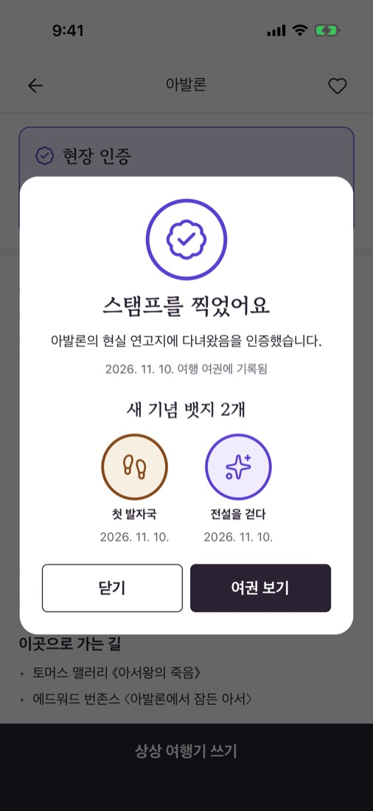 | 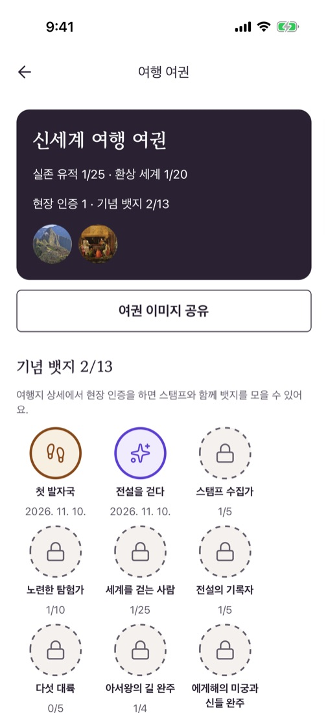 |

| 세계 지도                                                                                                                                  | 상상 여행기                                                                                                  |
| ------------------------------------------------------------------------------------------------------------------------------------------ | ------------------------------------------------------------------------------------------------------------ |
| 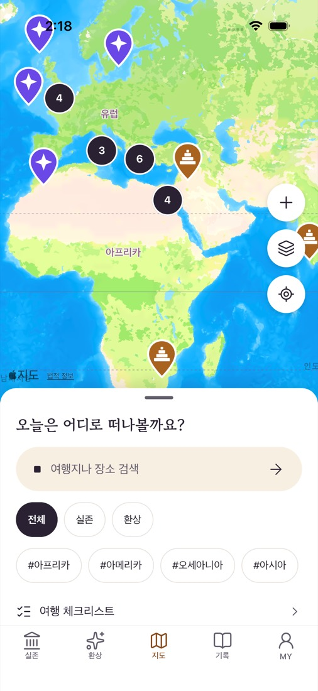 | 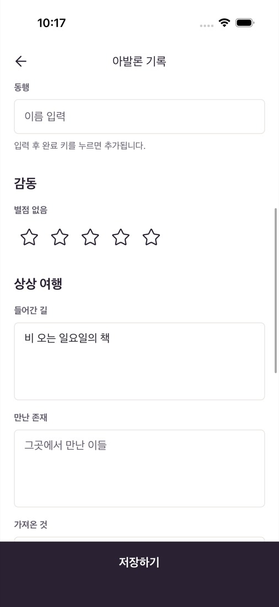 |

| MY                                                                                                                                                  | 프로필 편집                                                                                                                        |
| --------------------------------------------------------------------------------------------------------------------------------------------------- | ---------------------------------------------------------------------------------------------------------------------------------- |
| 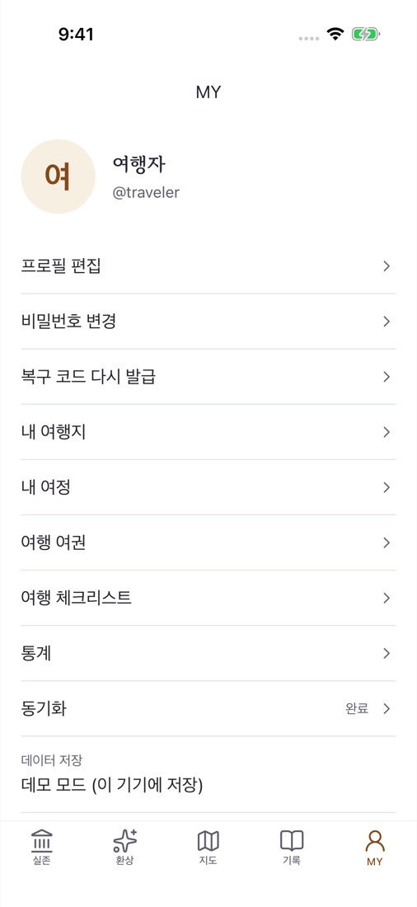 | 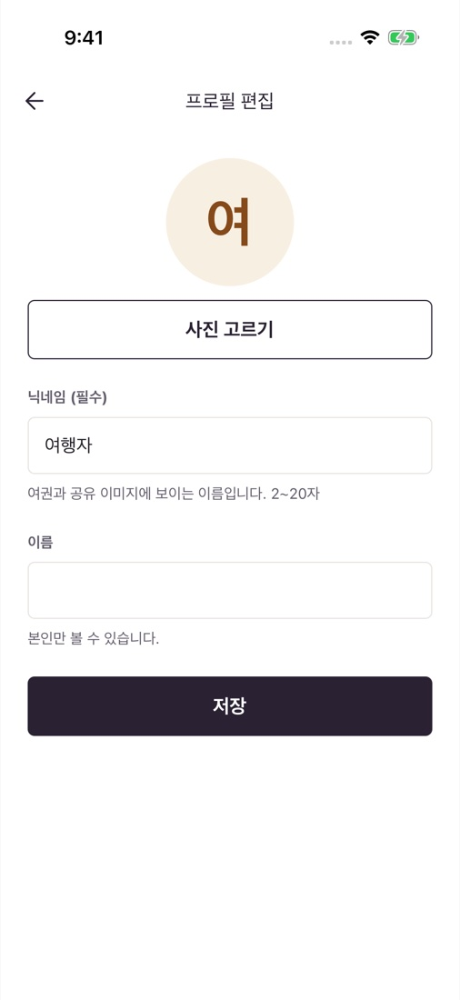 |

| 복구 코드                                                                                                                     | 도착 알림                                                                                                                                           |
| ----------------------------------------------------------------------------------------------------------------------------- | --------------------------------------------------------------------------------------------------------------------------------------------------- |
| 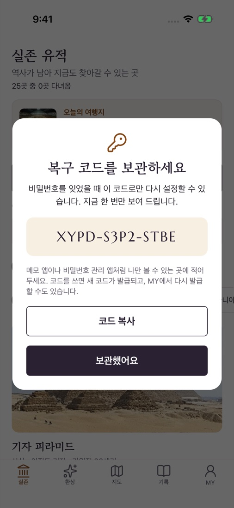 | 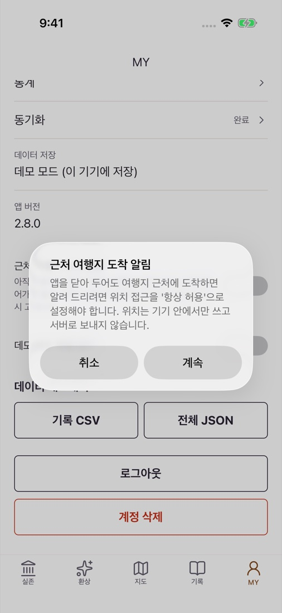 |

| 여행 체크리스트                                                                                  | 통계                                                                                                    |
| ------------------------------------------------------------------------------------------------ | ------------------------------------------------------------------------------------------------------- |
| 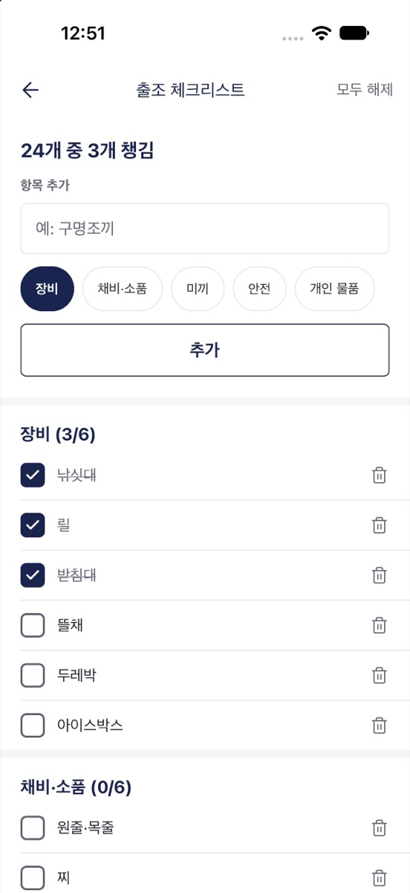 | 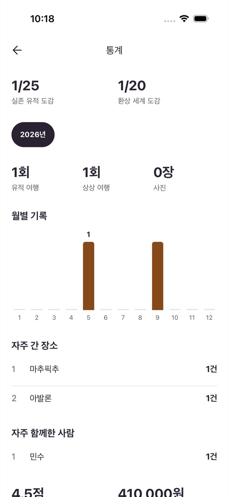 |

## 주요 기능

| 기능               | 내용                                                                                                          |
| ------------------ | ------------------------------------------------------------------------------------------------------------- |
| 실존·환상 탭       | 실존 유적 25곳(역사·사실)과 환상 세계 30곳(신화·전설), 분류·대륙·전승권 필터와 검색                           |
| 여행지 상세        | 소개, 볼거리, 가기 좋은 때, 여행 팁, 전승의 원전과 작품, 자료·사진 출처, 오프라인 열람                        |
| 지도               | 실존·환상 핀 구분, 현장 인증 핀과 필터, 핀 묶음, 위성 지도, 현재 위치, 직접 위치 지정, 장소 검색              |
| 여행 기록          | 실존: 날씨, 기온, 교통, 숙소, 비용 / 환상: 들어간 길, 만난 존재, 가져온 것 / 사진 10장, 별점                  |
| 가고 싶어요        | 여행지 저장, 다녀옴 표시, 도감 달성률                                                                         |
| 전설의 현장        | 전설과 실제 장소 연결, 추천 코스 9개(신화 코스 포함), 시대순 연대표, 저작권이 끝난 원전 읽기 링크             |
| 여정               | 여행지를 순서대로 묶기, 코스에서 시작, 경로 지도, 여정별 체크리스트                                           |
| 현장 인증·뱃지     | 현장(환상 세계는 연고지) 3km 안에서 위치로 인증해 스탬프, 기념 뱃지 21종, 근처 도착 알림                      |
| 여권·주변          | 인증·기록 스탬프, 여권·뱃지 공유 이미지, 가까운 순 정렬, 현장 도착 시 바로 기록                               |
| 오늘의 여행지·엽서 | 실존·환상 탭마다 하루 한 곳 추천, 여행지를 엽서 이미지로 미리 보고 공유                                       |
| 체크리스트         | 유적 여행·환상 여행 기본 목록, 여행별 목록 복사, 오프라인 체크                                                |
| 통계               | 도감 달성률, 연도별 여행 횟수, 자주 간 곳, 동행, 평균 별점과 비용                                             |
| 계정·동기화        | 아이디 가입과 로그인, 복구 코드, 닉네임·프로필 사진, 서버 동기화, 오프라인 저장, CSV·JSON 내보내기, 계정 삭제 |

## 기술 스택


| 구분        | 사용 기술                                                                                                                                                                  |
| ----------- | -------------------------------------------------------------------------------------------------------------------------------------------------------------------------- |
| 프레임워크  | Expo SDK 58, React Native 0.88, React 19, TypeScript, Expo Router                                                                                                          |
| UI          | Tamagui 3, Reanimated 4, Gesture Handler, Bottom Sheet, FlashList, Keyboard Controller, sonner-native, Lucide, view-shot, Expo Google Fonts(고운바탕, 고운돋움, Marcellus) |
| 지도·위치   | react-native-maps, supercluster, expo-location, expo-task-manager(지역 감시), expo-notifications                                                                           |
| 상태·데이터 | TanStack Query, zustand, MMKV, React Hook Form, Zod, dayjs                                                                                                                 |
| 서버        | Supabase(Postgres, RLS, Auth, Storage, Edge Functions), OpenStreetMap Photon, Open-Meteo                                                                                   |
| 품질        | ESLint, Prettier, husky, lint-staged, Jest, React Native Testing Library, PGlite, Maestro, Storybook                                                                       |
| 배포        | EAS Build, GitHub Actions                                                                                                                                                  |

## 시작하기

Node.js 24(`.nvmrc`)와 pnpm, Xcode 또는 Android Studio가 필요합니다.

```bash
pnpm install
pnpm run ios       # 또는 pnpm run android
```

로그인 화면의 **둘러보기**를 누르면 바로 시작할 수 있습니다.

| 명령                          | 설명                              |
| ----------------------------- | --------------------------------- |
| `pnpm start`                  | 개발 서버                         |
| `pnpm run lint` / `typecheck` | ESLint / 타입 검사                |
| `pnpm test`                   | 단위·컴포넌트 테스트              |
| `pnpm run test:db`            | DB 권한(RLS)과 제약 조건 테스트   |
| `pnpm run test:e2e`           | Release 빌드의 E2E 테스트         |
| `pnpm run test:e2e:server`    | 로컬 Supabase에 연결한 E2E 테스트 |
| `pnpm run assets`             | 앱 아이콘과 지도 핀 생성          |

서버 연결과 배포 방법은 [개발 가이드](docs/development.md)를 참고하세요.

## 프로젝트 구조

```
assets/        앱 아이콘, 지도 핀, 여행지 사진
docs/          문서, 스크린샷
e2e/           Maestro E2E 시나리오
scripts/       에셋 생성
supabase/      마이그레이션, Edge Functions, RLS 테스트
src/
├─ app/        Expo Router 경로 (_pages 재수출)
├─ _app/       Provider, 루트·탭 레이아웃
├─ _pages/     화면
├─ widgets/    지도, 홈 시트, 사진 갤러리, 동기화 배너, 현장 인증
├─ features/   로그인, 여행지 저장, 현장 인증, 뱃지, 주변 위치, 장소 검색, 장소·기록·여정 작성, 내보내기
├─ entities/   세션, 여행지 도감, 장소, 기록, 여정, 체크리스트, 현장 인증
└─ shared/     API, UI, 공통 유틸
```

## 문서

| 문서                               | 내용                                                       |
| ---------------------------------- | ---------------------------------------------------------- |
| [개발 가이드](docs/development.md) | 환경 변수, 서버 준비, 테스트, 배포, 디자인 토큰, 도감 자료 |
| [CHANGELOG](CHANGELOG.md)          | 버전 기록                                                  |
