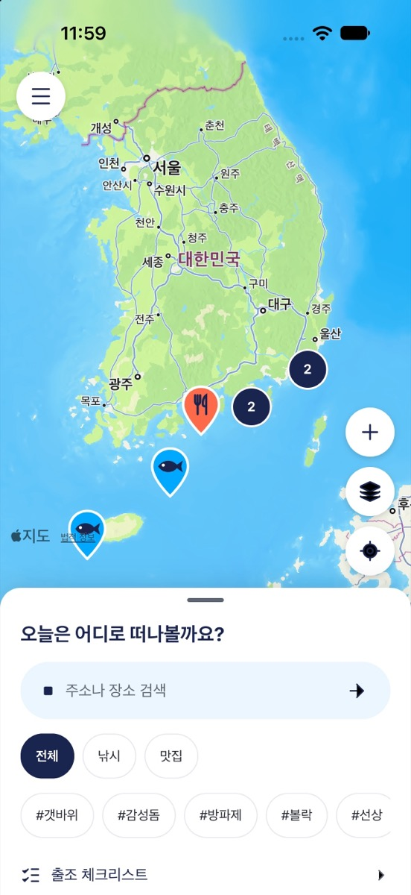
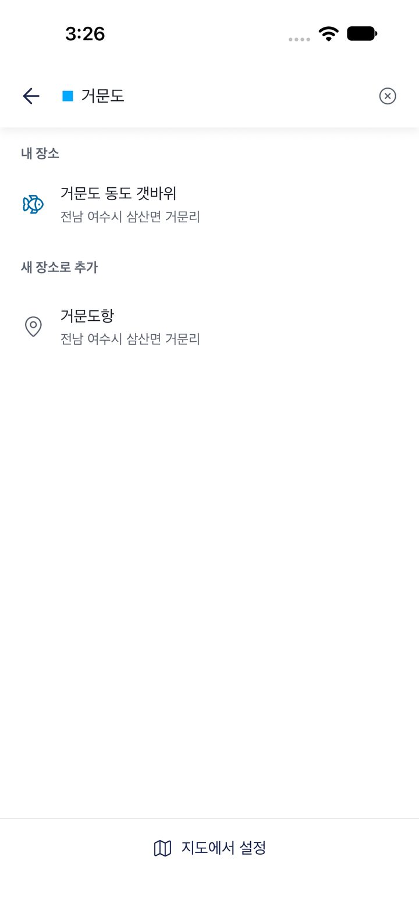
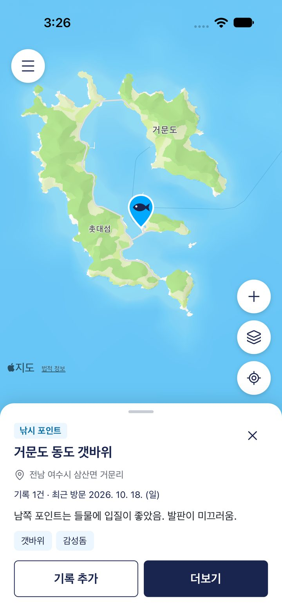
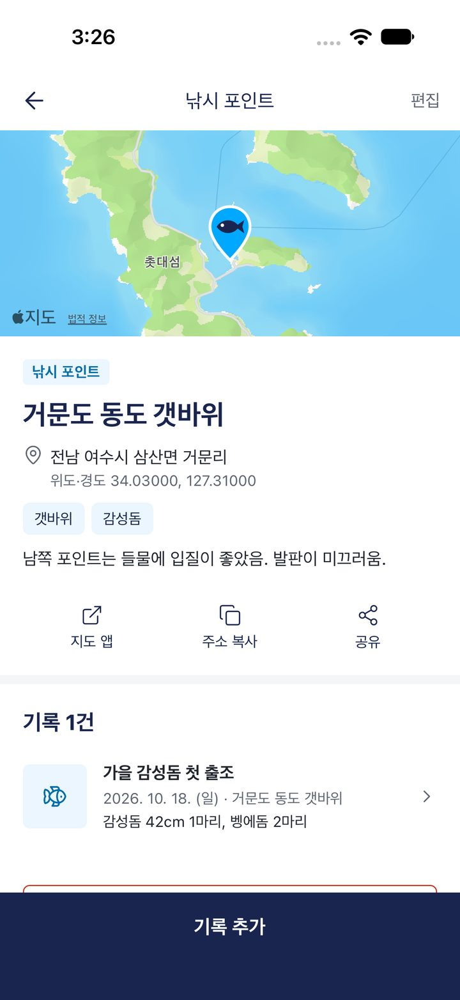
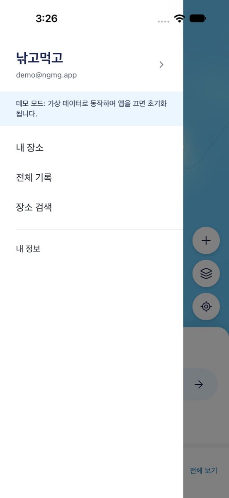

# NewWorld - 낚고먹고

[](https://github.com/ryushin01/NewWorld/actions/workflows/ci.yml)


낚시 포인트와 맛집의 위치를 지도에 저장하고 출조와 식사를 기록하는 모바일 앱입니다. 앱 이름은 **낚고먹고**입니다.

> **프로젝트 상태:** 직접 사용하기 위해 개발 중이며 스토어에는 출시하지 않았습니다. 서버 설정 값이 없으면 가상 데이터로 동작하는 데모 모드로 실행됩니다.

## 화면

화면의 장소, 기록, 사진은 모두 가상 데이터입니다.

| 지도                                                                                                  | 주소 검색                                                                                             |
| ----------------------------------------------------------------------------------------------------- | ----------------------------------------------------------------------------------------------------- |
|  |  |

| 핀 요약                                                                                                                        | 장소 상세                                                                                                                     |
| ------------------------------------------------------------------------------------------------------------------------------ | ----------------------------------------------------------------------------------------------------------------------------- |
|  |  |

| 기록 작성                                                                                                            | 서랍 메뉴                                                                                                                             |
| -------------------------------------------------------------------------------------------------------------------- | ------------------------------------------------------------------------------------------------------------------------------------- |
|  |  |

| 출조 체크리스트                                                                                                   | 통계                                                                                                         |
| ----------------------------------------------------------------------------------------------------------------- | ------------------------------------------------------------------------------------------------------------ |
|  |  |

## 주요 기능

| 기능            | 내용                                                                                                              |
| --------------- | ----------------------------------------------------------------------------------------------------------------- |
| 지도            | 분류별 핀 색상과 도형, 핀 묶음(클러스터), 위성 지도, 현재 위치, 길게 눌러 위치 지정                               |
| 검색            | 주소·장소 이름 검색, 위도·경도 변환, 지도 중앙 핀으로 위치 지정                                                   |
| 장소            | 낚시 포인트·맛집 분류와 자유 태그, 핀 요약과 더보기, 지도 앱 열기, 주소 복사, 공유                                |
| 낚시 기록       | 출조 인원과 멤버, 장비, 채비, 미끼, 날씨, 물때, 바람, 수온, 조과                                                  |
| 맛집 기록       | 동행, 메뉴, 가격, 별점                                                                                            |
| 사진            | 기록당 10장까지 다중 첨부와 촬영, 압축 후 업로드, 확대 보기                                                       |
| 출조 체크리스트 | 계정별 준비물 목록, 기본 목록, 분류, 체크 일괄 해제, 오프라인 체크                                                |
| 조건 자동 입력  | 음력으로 계산한 물때, 날씨, 바람, 수온, 지난 기록의 장비·채비 불러오기                                            |
| 찾기·통계       | 기록과 장소 검색, 태그 필터, 연도별 출조 횟수와 자주 간 장소·미끼·동행                                            |
| 계정·동기화     | 이메일 가입과 로그인, MY 페이지, 비밀번호 재설정, 서버 동기화, 오프라인 조회와 저장, CSV·JSON 내보내기, 계정 삭제 |

## 기술 스택


| 구분        | 사용 기술                                                                                                     |
| ----------- | ------------------------------------------------------------------------------------------------------------- |
| 프레임워크  | Expo SDK 58, React Native 0.88, React 19, TypeScript, Expo Router                                             |
| UI          | Tamagui 3, Reanimated 4, Gesture Handler, Bottom Sheet, FlashList, Keyboard Controller, sonner-native, Lucide |
| 지도·위치   | react-native-maps, supercluster, expo-location                                                                |
| 상태·데이터 | TanStack Query, zustand, MMKV, React Hook Form, Zod, dayjs                                                    |
| 서버        | Supabase(Postgres, RLS, Auth, Storage, Edge Functions), Kakao 로컬 API, Open-Meteo                            |
| 품질        | ESLint, Prettier, husky, lint-staged, Jest, React Native Testing Library, PGlite, Maestro, Storybook          |
| 배포        | EAS Build, GitHub Actions                                                                                     |

## 시작하기

Node.js 24(`.nvmrc`)와 pnpm, Xcode 또는 Android Studio가 필요합니다.

```bash
pnpm install
pnpm run ios       # 또는 pnpm run android
```

데모 모드에서는 아무 이메일과 비밀번호로 로그인할 수 있습니다.

| 명령                          | 설명                              |
| ----------------------------- | --------------------------------- |
| `pnpm start`                  | 개발 서버                         |
| `pnpm run lint` / `typecheck` | ESLint / 타입 검사                |
| `pnpm test`                   | 단위·컴포넌트 테스트              |
| `pnpm run test:db`            | DB 권한(RLS)과 제약 조건 테스트   |
| `pnpm run test:e2e`           | Release 빌드의 E2E 테스트         |
| `pnpm run test:e2e:server`    | 로컬 Supabase에 연결한 E2E 테스트 |
| `pnpm run assets`             | 앱 아이콘과 지도 핀 생성          |

서버 연결과 배포 방법은 [개발 가이드](docs/development.md)를 참고하세요.

## 프로젝트 구조

```
assets/        앱 아이콘, 지도 핀
docs/          문서, 스크린샷
e2e/           Maestro E2E 시나리오
scripts/       에셋 생성
supabase/      마이그레이션, Edge Functions, RLS 테스트
src/
├─ app/        Expo Router 경로 (_pages 재수출)
├─ _app/       Provider, 루트 레이아웃
├─ _pages/     화면
├─ widgets/    지도, 홈 시트, 서랍 메뉴, 사진 갤러리, 동기화 배너
├─ features/   인증, 장소 검색, 장소·기록 작성, 내보내기
├─ entities/   세션, 장소, 기록, 체크리스트
└─ shared/     API, UI, 공통 유틸
```

## 문서

| 문서                               | 내용                                            |
| ---------------------------------- | ----------------------------------------------- |
| [개발 가이드](docs/development.md) | 환경 변수, 서버 준비, 테스트, 배포, 디자인 토큰 |
| [CHANGELOG](CHANGELOG.md)          | 버전 기록                                       |
